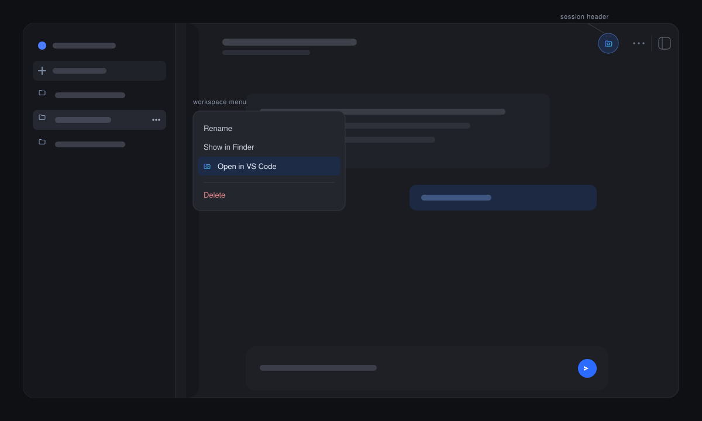

#  VS Code Quick Launch

**A DeepSeek Harness plugin that opens a workspace in VS Code from the sidebar
menu or the session header.**

VS Code Quick Launch puts the editor one click away. A workspace's `…` menu
gains an **Open in VS Code** row beside the shipped **Show in Finder** item,
and the session header gains the same action immediately left of its overflow
`…` button. The plugin asks the Host which applications are installed, so an
entry point appears only while VS Code is available.

## What you get

- **Workspace menu row** — right-click a workspace row, or use its `…` button,
  and choose **Open in VS Code**. It opens that workspace's folder.
- **Session header button** — the same action left of the header's overflow
  menu; it opens the current session's working directory.
- **Independent switches** — turn either entry point off in
  **Settings → General → VS Code Quick Launch**.
- **No new Host surface** — availability and launch reuse the shipped
  `open-in-app` routes.

## How it works

The plugin reads the Host's installed-application catalog once per page
(`open-in-app/apps`) and launches through `open-in-app/open` with the `vscode`
catalog id. The header entry registers in
`conversation.session.header.utilities` at order `-1`, immediately left of the
header's own overflow button (order `0`). A launch failure shows a toast; a
remote browser whose Host reports no local applications sees neither entry
point.

## Technical notes

- **Detection:** the Host catalog covers macOS (`Visual Studio Code.app`),
  Windows (`Code.exe`), and Linux (`code`); nothing is probed from the browser.
- **One read per page:** a failed availability read retries on the next opening
  instead of hiding the entry for the rest of the session.
- **Preferences:** both switches live in `localStorage` under
  `dsh.vscode-quick-launch.settings.v1`, apply instantly, and are migrated from
  the plugin's earlier key.
- **Copied path:** the header button opens the session's working directory,
  which is the workspace folder for an ordinary session. A session without a
  known directory hides the button.
- **Failure isolation:** a refused launch is reported as a toast; the rest of
  the header and the workspace menu are untouched.

## Install

1. In DSH, open **Plugins → Add plugin**.
2. Enter `https://github.com/awychoi/dsh-vscode-quick-launch`, or the absolute
   path to a local checkout.
3. Enable the bundle, then right-click a workspace row or look left of the
   session header's `…`.

## Uninstall

Remove **VS Code Quick Launch** from DSH's plugin list and restart DSH. The two
switches remain in `localStorage` only.

## Assets

`icon.svg` is the plugin icon. `icon-white.svg` is the transparent solid-white
mark for dark backgrounds. Exported as `./icon` and `./icon-white`.

## License

MIT. Copyright © 2026 awychoi.

Not affiliated with DeepSeek.
